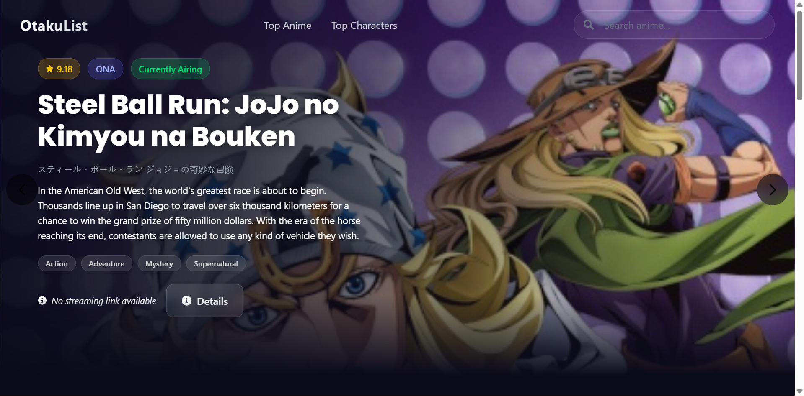
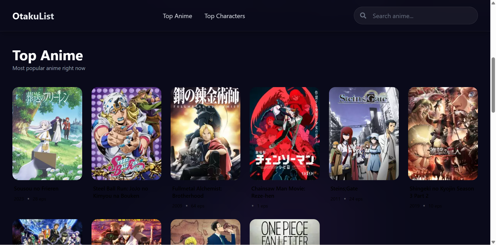
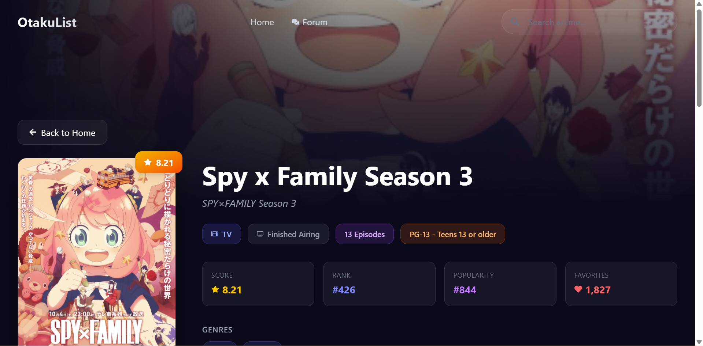
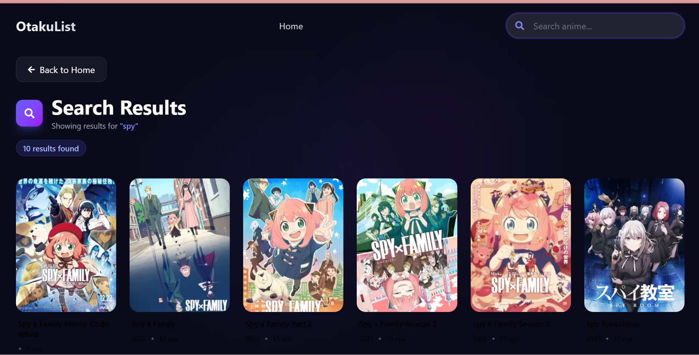
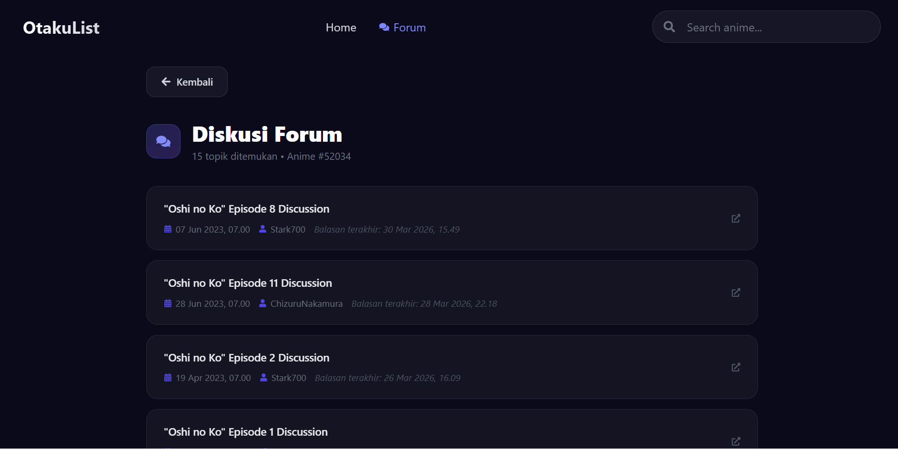
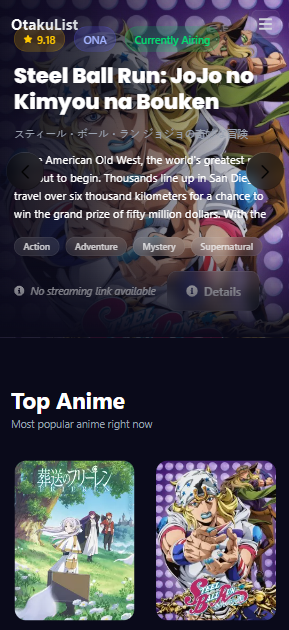

<div align="center">

# 🎌 OtakuList

**Platform pencarian & eksplorasi anime terlengkap berbasis data MyAnimeList**


[](https://react.dev/)
[](https://vitejs.dev/)
[](https://tailwindcss.com/)
[](https://jikan.moe/)

</div>

---

## 📋 Daftar Isi

- [Tentang Project](#-tentang-project)
- [Fitur Utama](#-fitur-utama)
- [Preview](#-preview)
- [Tech Stack](#-tech-stack)
- [Struktur Project](#-struktur-project)
- [Panduan Instalasi](#-panduan-instalasi)
- [Konfigurasi Environment](#-konfigurasi-environment)
- [Cara Menggunakan](#-cara-menggunakan)
  - [1. Halaman Utama (Home)](#1-halaman-utama-home)
  - [2. Carousel Featured Anime](#2-carousel-featured-anime)
  - [3. Top Anime & Manga](#3-top-anime--manga)
  - [4. Top Characters](#4-top-characters)
  - [5. Mencari Anime](#5-mencari-anime)
  - [6. Detail Anime](#6-detail-anime)
  - [7. Forum Diskusi Anime](#7-forum-diskusi-anime)
  - [8. Navigasi Header](#8-navigasi-header)
- [Struktur API](#-struktur-api)
- [Scripts](#-scripts)
- [Kontribusi](#-kontribusi)

---

## 🌟 Tentang Project

**OtakuList** adalah web app modern untuk mengeksplorasi dunia anime. Dibangun dengan React 19 + Vite, aplikasi ini memanfaatkan [Jikan API v4](https://jikan.moe/) (unofficial MyAnimeList API) untuk menampilkan data anime secara real-time — mulai dari daftar anime terpopuler, detail lengkap setiap anime, hingga forum diskusi komunitas.

> 💡 **Tidak perlu login, tidak perlu akun** — langsung bisa digunakan!

---

## ✨ Fitur Utama

| Fitur | Deskripsi |
|-------|-----------|
| 🏆 **Top Anime** | Daftar 20 anime terbaik versi MAL dengan lazy loading |
| 👥 **Top Characters** | Karakter anime paling favorit versi komunitas |
| 🔍 **Pencarian** | Cari anime apapun dengan pagination "Load More" |
| 📄 **Detail Anime** | Info lengkap: score, synopsis, trailer, studio, genre, dll |
| 💬 **Forum Diskusi** | Topik diskusi komunitas per-anime langsung dari MAL |
| 📱 **Responsive** | Tampilan optimal di desktop, tablet, dan mobile |
| ⚡ **Caching** | Data Top Anime di-cache ke localStorage untuk performa |
| 🌙 **Dark Mode** | Tema gelap elegan dengan glassmorphism effect |

---

## 🖼️ Preview

### Halaman Utama


### Top Anime Section


### Halaman Detail Anime


### Halaman Pencarian


### Forum Diskusi


### Tampilan Mobile


---

## 🛠️ Tech Stack

| Teknologi | Versi | Kegunaan |
|-----------|-------|----------|
| [React](https://react.dev/) | 19 | UI Framework |
| [Vite](https://vitejs.dev/) | 6 | Build Tool & Dev Server |
| [React Router DOM](https://reactrouter.com/) | 7 | Client-side Routing |
| [Axios](https://axios-http.com/) | 1.8 | HTTP Client untuk API |
| [TailwindCSS](https://tailwindcss.com/) | 4 | Utility CSS |
| [Swiper](https://swiperjs.com/) | 11 | Carousel / Slider |
| [Framer Motion](https://www.framer.com/motion/) | 12 | Animasi |
| [React Icons](https://react-icons.github.io/react-icons/) | 5 | Icon Library |
| [React Scroll](https://github.com/fisshy/react-scroll) | 1.9 | Smooth scroll navigation |
| [Jikan API v4](https://jikan.moe/) | v4 | Sumber data anime (MAL) |

---

## 📁 Struktur Project

```
streaming-anime/
├── public/                   # Static assets
├── src/
│   ├── assets/               # Gambar & aset statis
│   ├── components/           # Komponen reusable
│   │   ├── AnimeCard.jsx     # Kartu anime (thumbnail + info)
│   │   ├── AnimeCarousel.jsx # Carousel featured anime
│   │   ├── AnimeDetails.jsx  # Konten detail anime
│   │   ├── Footer.jsx        # Footer website
│   │   ├── Header.jsx        # Navigasi & search bar
│   │   ├── TopAnimeManga.jsx # Section Top Anime
│   │   └── TopCharacters.jsx # Section Top Characters
│   ├── hooks/
│   │   └── useAnimeForum.js  # Custom hook fetch forum data
│   ├── pages/
│   │   ├── AnimeDetails.jsx  # Page wrapper detail anime
│   │   ├── ForumPage.jsx     # Page forum diskusi
│   │   ├── Home.jsx          # Halaman utama
│   │   └── SearchPage.jsx    # Halaman hasil pencarian
│   ├── App.css               # Global styles & design system
│   ├── App.jsx               # Root component & routing
│   ├── index.css             # Base CSS reset
│   └── main.jsx              # Entry point React
├── .env                      # Environment variables
├── .gitignore
├── eslint.config.js
├── index.html
├── package.json
└── vite.config.js
```

---

## 🚀 Panduan Instalasi

### Prasyarat

Pastikan sudah terinstal di komputer Anda:

- **Node.js** versi `18` atau lebih baru — [Download](https://nodejs.org/)
- **npm** (sudah termasuk bersama Node.js) atau **pnpm** / **yarn**
- **Git** — [Download](https://git-scm.com/)

Cek versi Node.js:
```bash
node --version
# Harus menampilkan v18.x.x atau lebih baru
```

---

### Langkah 1 — Clone Repository

```bash
git clone https://github.com/yafaiky/streaming-anime.git
cd streaming-anime

```
---

### Langkah 2 — Install Dependencies

```bash
npm install
```

Tunggu hingga proses selesai. Semua package yang diperlukan akan terunduh otomatis.


---

### Langkah 3 — Buat File Environment

Buat file `.env` di root project

```bash
# Windows (Command Prompt)
copy .env.example .env

# Windows (PowerShell) / Linux / macOS
cp .env.example .env
```

Atau buat manual dengan isi berikut:

```env
VITE_ANIME_API_BASE_URL=https://api.jikan.moe/v4
```

> ℹ️ Jikan API adalah **free & open source** — tidak memerlukan API key apapun!

---

### Langkah 4 — Jalankan Development Server

```bash
npm run dev
```

Buka browser dan akses:

```
http://localhost:5173
```

🎉 **OtakuList siap digunakan!**

---

## ⚙️ Konfigurasi Environment

File `.env` hanya memiliki satu variabel:

```env
VITE_ANIME_API_BASE_URL=https://api.jikan.moe/v4
```

| Variabel | Nilai Default | Keterangan |
|----------|---------------|------------|
| `VITE_ANIME_API_BASE_URL` | `https://api.jikan.moe/v4` | Base URL Jikan API v4 |

> ⚠️ **Penting:** Semua variabel environment di Vite **harus** diawali dengan `VITE_` agar bisa diakses di dalam kode React.

---

## 📖 Cara Menggunakan

### 1. Halaman Utama (Home)

Saat membuka `http://localhost:5173`, Anda akan melihat **Halaman Utama** yang terdiri dari:

1. **Header/Navbar** — di bagian atas halaman
2. **Section Top Anime** — daftar anime terbaik
3. **Section Top Characters** — karakter paling favorit
4. **Footer** — di bagian bawah halaman

---

### 2. Carousel Featured Anime

Carousel menampilkan anime-anime terpopuler secara otomatis.


**Yang bisa dilakukan:**
- ▶️ Slide berpindah **otomatis** setiap beberapa detik
- ◀️ ▶️ Klik **tombol panah** kiri/kanan untuk navigasi manual
- 🔵 Klik **dot indikator** di bawah untuk lompat ke slide tertentu
- 🎬 Klik tombol **"Watch Now"** / **"View Details"** untuk melihat detail anime
- ⭐ Melihat **score** dan **synopsis** singkat setiap anime

---

### 3. Top Anime & Manga

Section ini menampilkan 20 anime terbaik berdasarkan rating MyAnimeList.

**Yang bisa dilakukan:**
- 👁️ Awalnya hanya ditampilkan **10 anime pertama**
- ⬇️ Klik tombol **"See More"** untuk menampilkan semua 20 anime
- ⬆️ Klik tombol **"Show Less"** untuk menyembunyikan kembali
- 🖱️ **Hover** pada kartu anime untuk melihat synopsis singkat
- 🔗 **Klik kartu anime** untuk membuka halaman detail

---

### 4. Top Characters

Section ini menampilkan karakter anime yang paling banyak difavoritkan oleh komunitas MAL.

**Yang bisa dilakukan:**
- Melihat foto, nama, dan jumlah favorit setiap karakter
- Navigasi melalui daftar karakter populer

---

### 5. Mencari Anime

1. Klik kolom pencarian di pojok kanan atas header
2. Ketik nama anime yang dicari (contoh: `Naruto`, `One Piece`, `Attack on Titan`)
3. Tekan **Enter** atau klik ikon 🔍

---

### 6. Detail Anime

Klik kartu anime manapun untuk membuka halaman detail.

URL format: `/anime/{id}` — contoh: `/anime/1` (Cowboy Bebop)

**Informasi yang ditampilkan:**

| Bagian | Isi |
|--------|-----|
| 🖼️ **Hero Banner** | Background gambar anime dengan overlay gradient |
| 🎨 **Cover Image** | Poster anime dengan badge score |
| 📝 **Judul** | Judul bahasa Inggris & Jepang |
| 🏷️ **Badges** | Tipe (TV/Movie/OVA), Status, Jumlah Episode, Rating usia |
| ⭐ **Stats** | Score, Rank, Popularity, Jumlah Favorites |
| 🎭 **Genres & Themes** | Genre dan tema anime |
| 👥 **Demographics** | Target demografi penonton |
| 🏢 **Studio & Producer** | Studio dan produser anime |
| 📅 **Aired & Duration** | Tanggal tayang dan durasi episode |
| 📖 **Synopsis** | Ringkasan cerita anime |
| 🎬 **Trailer** | Video trailer (jika tersedia) via YouTube embed |

**Tombol aksi:**
- 🔗 **"View on MyAnimeList"** — Buka halaman MAL resmi anime
- 💬 **"Lihat Forum Diskusi"** — Buka forum diskusi anime ini
- ◀️ **"Back to Home"** — Kembali ke halaman sebelumnya

---

### 7. Forum Diskusi Anime

Setiap anime memiliki halaman forum diskusi dari komunitas MyAnimeList.

**Cara mengakses forum:**

**Cara 1 — Via tombol di halaman Detail Anime:**

Klik tombol **"Lihat Forum Diskusi"** di halaman detail anime.

**Cara 2 — Via link di Header:**

Saat berada di halaman detail anime (`/anime/:id`), link **"Forum"** akan otomatis muncul di navbar.

**Cara 3 — Langsung via URL:**

```
http://localhost:5173/anime/1/forum
```

Ganti `1` dengan ID anime yang diinginkan.

---

**Informasi yang ditampilkan per topik:**

| Info | Keterangan |
|------|------------|
| 📄 **Judul Topik** | Nama thread diskusi |
| 📅 **Tanggal** | Tanggal topik dibuat (format: DD MMM YYYY) |
| 👤 **Pembuat** | Username pembuat topik |
| 💬 **Balasan Terakhir** | Tanggal balasan terakhir |
| 🔗 **Ikon Eksternal** | Klik kartu → buka thread di MAL |

**State yang ditangani:**
- ⏳ **Loading** — Skeleton placeholder selama data diambil
- ❌ **Error** — Pesan error + tombol **"Coba Lagi"** untuk retry
- 📭 **Kosong** — Pesan jika belum ada topik diskusi
- ✅ **Data tersedia** — Daftar topik dengan animasi masuk bertahap

---

### 8. Navigasi Header

Header selalu terlihat di bagian atas di semua halaman (fixed/sticky).

**Elemen Header:**

| Elemen | Fungsi |
|--------|--------|
| 🏷️ **Logo "OtakuList"** | Klik untuk kembali ke Home |
| **Top Anime** *(hanya di Home)* | Smooth scroll ke section Top Anime |
| **Top Characters** *(hanya di Home)* | Smooth scroll ke section Top Characters |
| **Home** *(di halaman lain)* | Kembali ke halaman utama |
| **Forum** *(di halaman detail anime)* | Buka forum diskusi anime tersebut |
| 🔍 **Search Bar** | Cari anime (tekan Enter untuk submit) |
| 🍔 **Hamburger Menu** | Buka menu mobile (di layar kecil) |

**Perilaku Header:**
- Header **transparan** saat di bagian atas halaman
- Header menjadi **blur/frosted glass** saat scroll ke bawah

---

## 🔌 Struktur API

Aplikasi ini menggunakan **[Jikan API v4](https://docs.api.jikan.moe/)** — wrapper tidak resmi untuk MyAnimeList.

| Endpoint | Digunakan Di | Keterangan |
|----------|-------------|------------|
| `GET /top/anime` | Home, TopAnimeManga | Daftar anime terpopuler |
| `GET /top/characters` | Home, TopCharacters | Karakter terfavorit |
| `GET /anime?q={query}` | SearchPage | Pencarian anime |
| `GET /anime/{id}` | AnimeDetails | Detail 1 anime |
| `GET /anime/{id}/forum` | ForumPage | Forum diskusi anime |

> 📌 Base URL: `https://api.jikan.moe/v4`
>
> ⚠️ **Rate Limit Jikan API:** Maksimal 3 request/detik dan 60 request/menit. Jika terlalu banyak request, API akan mengembalikan error `429 Too Many Requests`.

---

## 📜 Scripts

Perintah yang tersedia di `package.json`:

```bash
# Menjalankan development server (hot reload)
npm run dev

# Build untuk production
npm run build

# Preview build production secara lokal
npm run preview

# Menjalankan linter ESLint
npm run lint
```

---

## 🤝 Kontribusi

Kontribusi sangat disambut! Ikuti langkah berikut:

1. **Fork** repository ini
2. Buat **branch** baru: `git checkout -b fitur/nama-fitur`
3. **Commit** perubahan: `git commit -m "feat: tambahkan fitur X"`
4. **Push** ke branch: `git push origin fitur/nama-fitur`
5. Buka **Pull Request**

### Konvensi Commit

```
feat:     Fitur baru
fix:      Perbaikan bug
docs:     Perubahan dokumentasi
style:    Perubahan formatting/style (bukan logic)
refactor: Refactoring kode
perf:     Peningkatan performa
```

---

## 📄 Lisensi

Project ini menggunakan lisensi **MIT** — bebas digunakan, dimodifikasi, dan didistribusikan.

---

<div align="center">

**Dibuat dengan ❤️ menggunakan React + Vite**

Data anime disediakan oleh [Jikan API](https://jikan.moe/) · [MyAnimeList](https://myanimelist.net/)

</div>
